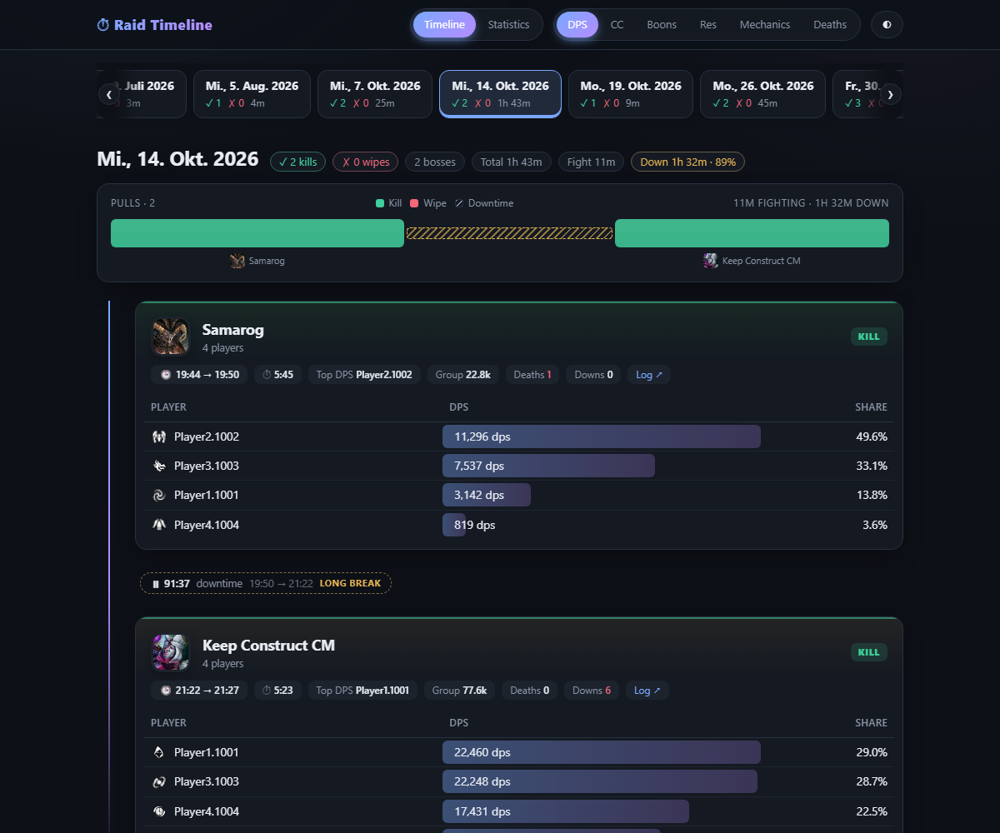

# Raid Timeline

Ever wanted to to see an overview of the raid you just ran?  
Interested in displaying your Elite Insight logs in a nice and beautiful way?  
Need some tools to parse / upload you log files?

This might be for you:



An example timeline can also be found in the `media` folder.

## RaidTimeline.App (rta) 🤖

```
Usage: rta [command]

rta

Commands:
  open      Opens the current timeline file.
  config    Commands for your settings.
  parse     Commands for parsing log files.
  clean     Commands to clean log file folders and free up space.
  size      Commands to show the disk space taken by logs.
  upload    Commands for uploading html and log files.
```

### Features

* Parse arcdps and Elite Insights files into a timeline of your raid
* Use either a local Elite Insights or dps.report as a parser for arcdps logs
* Upload logs to dps.report and get the links back for easy copy & paste action 😉
* Parse new logs "live" as they are written by arcdps (only works with local EI at the moment)
* Upload logs to a "generic" REST endpoint (currently built to support the one my guild uses)
* Show the disk usage of the arcdps and EI logs
* Delete / Clean logs from disk

### Installation

**As a .NET tool** (needs the [.NET 10 SDK](https://dotnet.microsoft.com/download), works on Windows, Linux and macOS):

```bash
dotnet tool install -g rta
```

Update with `dotnet tool update -g rta`. The tool is also attached to every
[release](https://github.com/danifischer/raidTimeline/releases/latest) as `rta.<version>.nupkg`; install that file with
`dotnet tool install -g rta --add-source <folder with the nupkg> --version <version>`.

**Or as a single file** (Windows, no .NET installation needed):

1. Download `rta-v<version>-win-x64.zip` from the [latest release](https://github.com/danifischer/raidTimeline/releases/latest)
   (`SHA256SUMS.txt` lets you verify the download)
2. Unpack the zip file and run `rta.exe` via command line (you can put the folder in your `PATH` variable for easy access)
3. To update, replace the files with the ones of the new zip; your settings stay (see Configuration)

Then run `rta config edit` and enter the options you need (see Configuration).

### Configuration

Your settings live in **your own file** in your user folder, so updates never touch them:

| | |
|---|---|
| Windows | `%APPDATA%\rta\config.json` |
| Linux / macOS | `~/.config/rta/config.json` |

* `rta config edit` creates the file (with the settings you currently have) and opens it
* `rta config path` prints where it is, `rta config log` prints the folder of the log files (`rta_log.txt`, kept for 7 days)
* Set the environment variable `RTA_HOME` to a folder to keep settings and logs there instead (e.g. a portable installation)

Settings are read in this order, a later file overrides an earlier one: the `config.json` that comes with rta (defaults,
do not edit it, an update replaces it), a `config.local.json` next to it (older versions asked to use it), and finally your file.
If you put values into the `config.json` next to rta before, they still work; `rta config edit` copies them into your file.

```json
{
  // Options needed to parse locally
  "eiPath": "",
  "configurationPath": "",
  
  // Options needed to interact with dps.report
  "dpsReportToken": "",
  "outputPath": "",
  "logPath": "",
  
  // Boss encounter ids filter (same ids as the arcdps.ini uses), the default is all raid bosses
  // "bossEncounterIdFilter": "0x3C4E,0x3C45,...",

  // Endpoint upload 
  "endpointUri": "",
  "endpointKey": "",
  "endpointIv": "",
}
```

> **Keep secrets out of git:** your settings file is outside of any repository. Never put the token or the keys into
> the `config.json` that ships with rta.

#### Local parsing with Elite Insights

* `eiPath`: the path to the Elite Insights `.exe` file
* `configurationPath`: the path to the configuration file Elite Insights uses to store your settings

By using the local parsing the folder which is used by arcdps to save the logs and the folder that Elite 
Insights uses to store its output is taken from the Elite Insights configuration.

**Elite Insights has to write json files** (the timeline is built from them). Enable `SaveOutJSON` in the 
Elite Insights settings (`SaveOutJSON=true` in the configuration file). Keep `SaveOutHTML` enabled as well if the 
timeline should link to the html logs: the link points to the html file Elite Insights writes next to the json.
Elite Insights 3.x is required, logs in the old html-only format are not supported anymore.

#### dps.report settings

* `dpsReportToken`: the user token you have for dps.report. You can find out yours by opening https://dps.report/getUserToken
* `outputPath`: the path that you want the html timeline file to be saved to. Only needed when you do not use Elite Insights.
* `logPath`: the path where arcdps saves the log files. Normally something like `C:\Users\<user>\Dokumente\Guild Wars 2\addons\arcdps\arcdps.cbtlogs`. Only needed when you do not use Elite Insights.

#### Encounter filter

* `bossEncounterIdFilter`: the hexadecimal values of enemies you want to filter for. The default value is all raid bosses. A list of ids can be found on the GW2 wiki: https://wiki.guildwars2.com/wiki/User:Jowjowjow/npcids

#### Generic upload

* `endpointUri`: the uir that is used for uploading html files.
* `endpointKey`: key of the RijndaelManaged encryption in Base64.
* `endpointIv`: key of the RijndaelManaged encryption in Base64.

### Some information

#### How is the timeline created

The timeline takes the json files created by Elite Insights (or the json provided by dps.report) and creates a single
html page (`index.html`) where you can:

* Switch between your raid days with tabs and see how long a day took and how long you were in and out of combat
* See an overview strip of all pulls of a day, including the downtime between them
* See how many bosses you tried / killed / failed; several tries of one boss are grouped, with a comparison to the previous try
* See the damage, crowd control, boon uptime, resurrects, mechanic fails, downs and deaths of every player
* See the health of the boss when you wiped
* See the statistics over all days (kill rate and time per encounter, downs and deaths) on the Statistics tab
* Click on the try to go to the log (the html log of Elite Insights, or the dps.report page)

This is done by parsing the Elite Insights json files and combining the information from the log files.
The format is documented at https://baaron4.github.io/GW2-Elite-Insights-Parser/Json/index.html.

The page contains the parsed data as json and draws everything in the browser, so it needs JavaScript. The layout lives
in `raidTimeline.Logic/template.html`; `TimelineDataBuilder` writes the data into it.
Older versions also wrote a `statistics.html`; it is not created anymore (the statistics are part of `index.html`) and
an old one next to it is left alone, you can delete it.

The table with the players who failed the most mechanics comes from the encounter (trigger) id of the log.
Encounters without a definition (strikes, fractals, new content) show the three mechanics the players triggered most.

#### dps.report upload

Please use the dps.report upload with care and do not spam it with all logs that you have. 
It will upload multiple logs in parallel but is limited to 3 at the same time.

## Information for developers

### Generic endpoint upload

The generic endpoint is built against the REST API that my guild has, so it will not fit to all APIs.
Some information around that:

* The files are encrypted by a RijndaelManaged encryption before the upload and need to be decrypted by the receiver.
* The endpoint for upload is `<endpointUri from the config.json>/<raidGroup>/<date as dd.MM.yyyy>/<filename of the log>` and uses a `http put`. The file is in the `content`of the http request.
* After all files are uploaded  `<endpointUri from the config.json>/<raidGroup>/<date as dd.MM.yyyy>` will be called with `http post` (this triggers the timeline creation on our the server)

### raidTimeline.Logic.dll

The `raidTimeline.Logic.<version>.nupkg` is attached to every release.
Feel free to use the `raidTimeline.Logic.dll`, it provides an interface `ITimelineCreator` and the `TimelineCreator`.  
With these you can build your own tools if you want.

### Boss mechanics

The columns of the mechanics table are data, not code: `raidTimeline.Logic/Mechanics/mechanics.json`.

```json
{ "name": "Gorseval", "ids": [15429], "columns": [
    { "key": "gors_kick", "label": "Kick", "title": "Kicked by small add", "mechanics": ["Kick.S"] }
] }
```

* `ids`: the `triggerID` of the Elite Insights json (the folder numbers of arcdps, e.g. `Gorseval the Multifarious (15429)`)
* `mechanics`: short names of the Elite Insights mechanics which are added up; `subtract` removes mechanics which are a part of another one (e.g. hits that were stabilized)
* `rank: false` shows a column without using it to choose the players with the most fails
* `ignoredMechanics` are the mechanics every encounter has; they are not shown for encounters without a definition

#### Your own bosses

You do not have to change the program for a new encounter or a renamed mechanic: `rta config mechanics` opens
`mechanics.json` in your settings folder (next to your `config.json`, `rta config path` shows where). It has the same
format as the shipped file. An encounter in it replaces the shipped encounter with the same id, new ids are added and
`ignoredMechanics` are added to the shipped ones. If the file is invalid, rta prints the reason and uses the shipped
definitions.

Elite Insights renames mechanics from time to time and a missing name counts as 0. Look at `mechanics` in a json
log for the current names (Elite Insights only lists the mechanics which happened in that log). Every encounter has a
small anonymized real log in `raidTimeline.Logic.Tests/Files` (`BossMechanicsTests` checks all columns of all of them):

1. Parse a log with Elite Insights (`SaveOutJSON=true`) and shrink it: `python trim_ei_json.py log.json new_kill.json --players 4 --anonymize --minimal --rank <mechanics>`
2. Run `python make_expected_columns.py` to calculate the expected values from the json (a second implementation of the counting) and review the diff

## Special thanks / Mentions

* To the whole [Elite Insights](https://github.com/baaron4/GW2-Elite-Insights-Parser) team, you provide a great product. Keep on coding 👍  
* To [dps.report](https://dps.report) for their great API  
* To the [Guild Wars 2 Wiki](https://wiki-de.guildwars2.com/wiki/Hauptseite), which as great icons 😜
* To the [Cocona](https://github.com/mayuki/Cocona) project with allows for nice command line tools

## Contact

Best via this GitHub Page: https://github.com/danifischer/raidTimeline

Just open an issue if you want a feature or find a bug.


